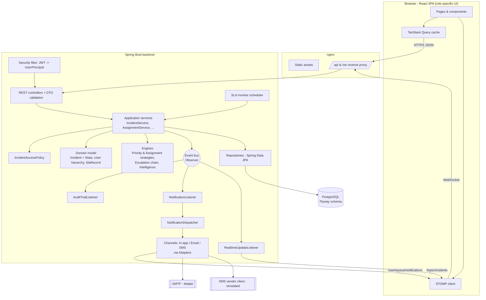
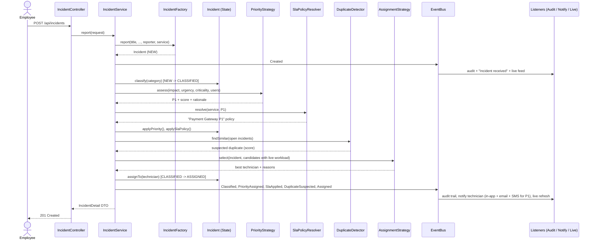
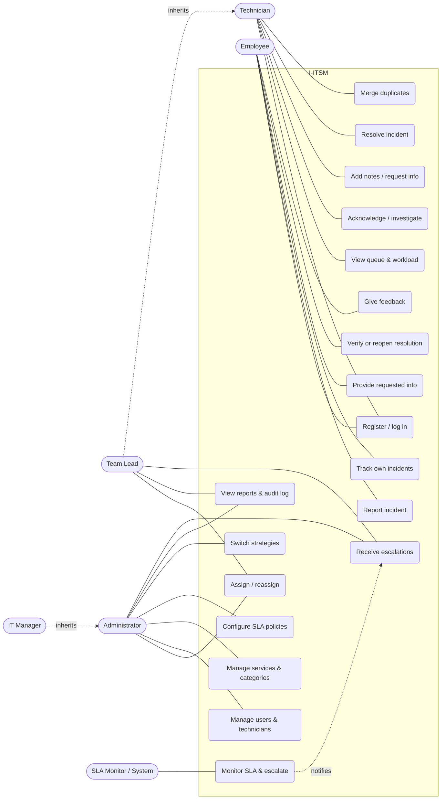
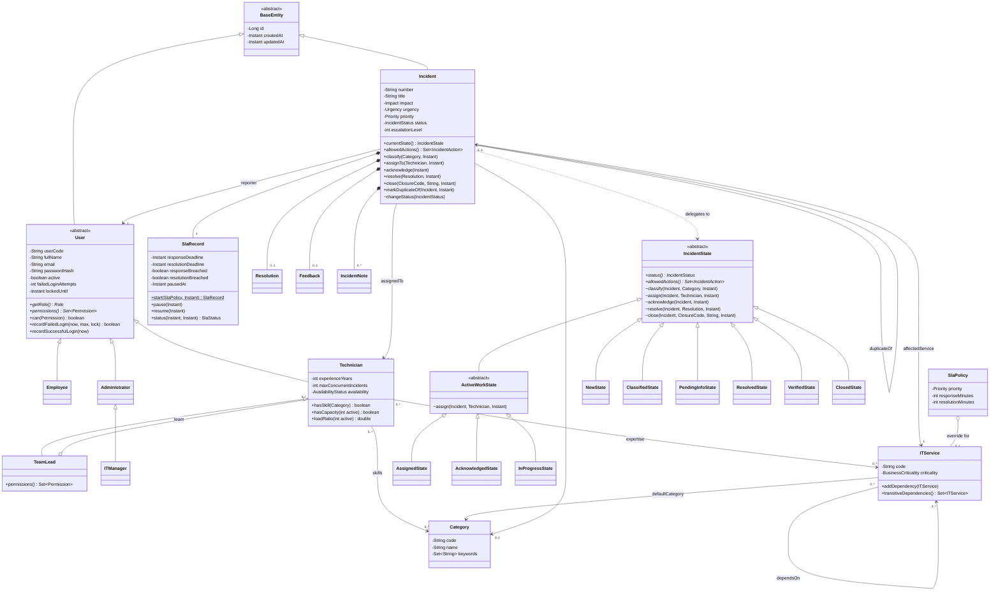
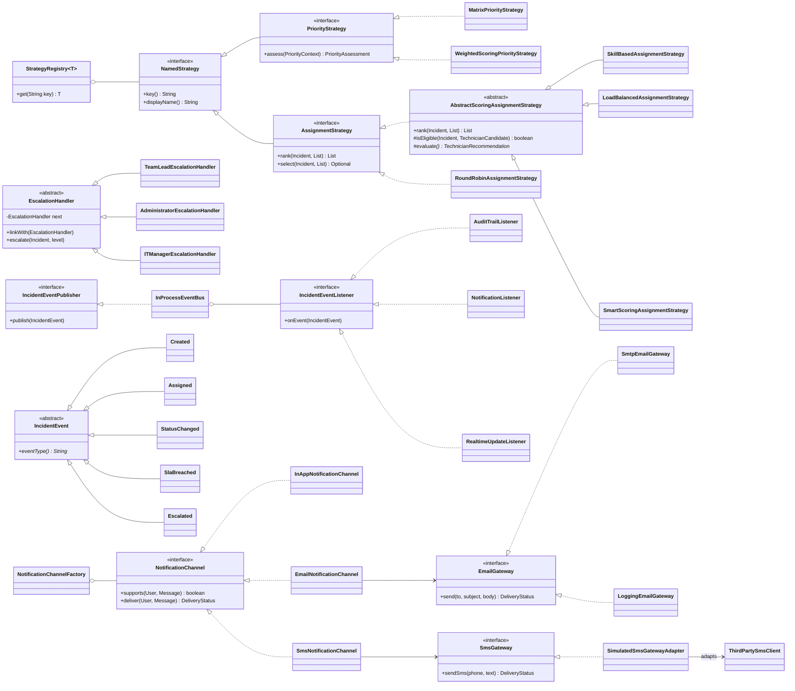
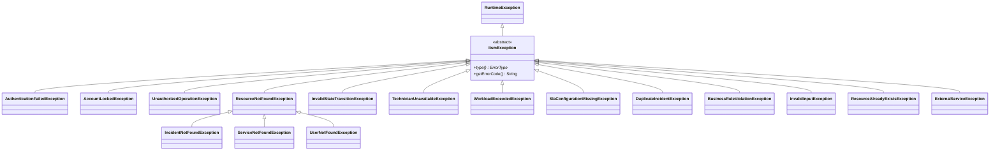
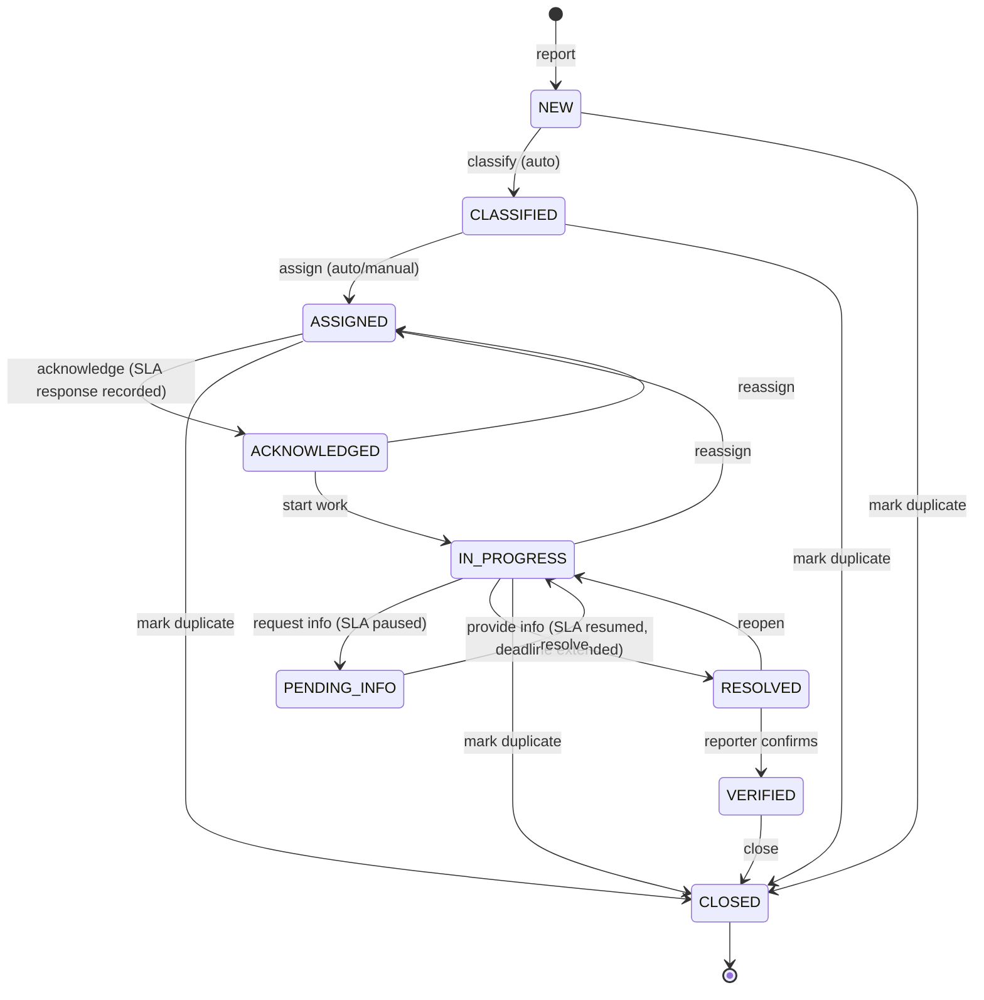
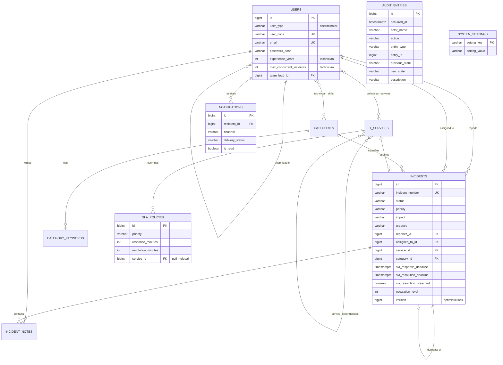

# I-ITSM — System Design

All diagrams are Mermaid and render on GitHub. For the PDF report, paste a diagram into
https://mermaid.live and export it as PNG or SVG.

## 1. Architecture

Layered architecture (the brief's "Choice 1"), with an event-driven core for side effects.

**Request lifecycle — report an incident**

## 2. Use case diagram

## 3. Class diagram (core domain)

**Engines, events and notifications (interfaces and patterns)**

**Exception hierarchy**

## 4. Incident lifecycle (State pattern)

Every other combination (for example NEW → CLOSED via *close*, or RESOLVED → resolve)
throws `InvalidStateTransitionException`. The default method on the abstract `IncidentState`
rejects the action, and only the states that permit it override the method. The UI hides
buttons using `allowedActions()`, but the domain enforces the rule regardless.

## 5. Database design (ER diagram)

Notes:
- **Single-table inheritance** for `users`. The discriminator `user_type` maps to the concrete
  Java subclass. It was chosen over joined tables because the subclasses add only a few
  columns, and polymorphic queries are frequent.
- `SlaRecord`, `Resolution` and `Feedback` are `@Embeddable` (composition), so they are stored
  as columns of `incidents`.
- `audit_entries` keeps denormalised actor data, so the history survives user changes.
- Indexes cover every search filter (status, priority, service, category, assignee, reporter,
  reported_at).
- The schema is owned by Flyway (`V1__initial_schema.sql`). Hibernate runs in `validate` mode,
  and the test suite runs the same migration, so drift between entities and schema fails the build.

## 6. Algorithms and rationale

### 6.1 Priority determination (two interchangeable strategies)
- **Matrix (default):** `score = Impact × Urgency × BusinessCriticality`, each factor 1–4, so
  the score ranges 1–64. P1 ≥ 32, P2 ≥ 16, P3 ≥ 6, otherwise P4.
  Multiplication lets one low factor pull the priority down sharply: a "critical" problem on a
  low-criticality service is not a P1.
- **Weighted:** a 0–100 score = 35% impact + 30% urgency + 20% criticality + 15% user reach
  (`log10(users)/3`). It adds **+8** when the same service had 3 or more incidents in the last
  24 hours, which signals a recurring or systemic problem. This is historical-data-based
  prioritisation. Bands: P1 ≥ 75, P2 ≥ 55, P3 ≥ 35, otherwise P4.
- Each assessment stores a human-readable **rationale**, shown on the incident and in the audit trail.

### 6.2 Technician assignment (four interchangeable strategies)
| Strategy | Rule |
|---|---|
| Skill-based | Only technicians skilled in the category; the least-loaded wins |
| Load-balanced | Lowest workload ratio wins; matching skill gives a +0.1 bonus |
| Round-robin | Per-category rotation among skilled technicians with capacity |
| **Smart (default)** | 0.40 skill + 0.25 spare capacity + 0.15 experience + 0.10 past success on the service + 0.10 priority fit (seniors for P1/P2) |

Every strategy excludes technicians who are unavailable or at capacity. A manual assignment
beyond capacity raises `WorkloadExceededException`.

### 6.3 SLA management
- The applicable policy is the service-specific one if it exists, otherwise the global default.
  If neither exists, `SlaConfigurationMissingException` is raised.
- Deadlines are computed from the reported time. The clock **pauses in PENDING_INFO**, and on
  resume both deadlines move by the paused duration.
- The background monitor runs every 60 seconds. It raises a one-time warning at the policy's
  threshold (75%), records response and resolution breaches once each, and escalates.
- **Escalation (Chain of Responsibility):** an unacknowledged P1/P2 escalates to level N after N×
  the response target (Team Lead → Administrator → IT Manager). A resolution breach escalates
  one more level. A level with nobody available is skipped upward.

### 6.4 Intelligent features (A–G)
| | Feature | How |
|---|---|---|
| A | Duplicate detection | Tokenise, remove stop words, map domain synonyms ("unavailable/failing/unable" → `fail`), stem, then compute TF-IDF cosine. Score = 0.6 text + 0.3 service relation + 0.1 time proximity. ≥ 0.50 marks a suspected duplicate. The same reporter submitting text ≥ 85% similar within 30 minutes raises `DuplicateIncidentException` |
| B | Correlation | Each open incident votes for its service and the service's direct dependencies. Services are taken greedily by vote count. A cluster of 3 or more is a **major incident**: one alert per root service per hour |
| C | Automatic escalation | SLA monitor plus the escalation chain (6.3) |
| D | Smart recommendation | Smart scoring strategy, with explainable reasons per candidate |
| E | SLA risk prediction | Historical mean time-to-resolve (same priority and category), adjusted for time spent, assignee workload and unassigned status. risk = 0.5 × elapsed + 0.5 × pressure |
| F | Auto-categorisation | Keyword scoring from admin-maintained category keywords (title × 2, description × 1, plus the service's default category). Pluggable `CategorySuggester` interface, ready for an AI implementation |
| G | Suggested resolution | TF-IDF similarity against resolved history (same category gets +0.1). The top 3 can be applied with one click |

## 7. Security design
- **Authentication:** BCrypt password hashes; stateless HMAC-SHA256 JWT (8 h); generic login
  errors; constant-time path for unknown e-mails; **lockout** for 15 minutes after 5 failures.
- **Authorization:** three layers.
  1. URL rules (`/api/admin/**` is admin only).
  2. `@PreAuthorize` on permissions that are **derived polymorphically from the `User` subclass**.
  3. Object-level checks in `IncidentAccessPolicy`: reporters see only their own incidents,
     only the assignee works an incident, and internal notes are hidden from reporters.
- **Input validation:** Bean Validation on every DTO, plus domain invariants in constructors
  (defence in depth).
- **API hardening:** CORS allow-list, no sessions, so CSRF is not applicable; frame-deny header;
  RFC 7807 errors with no stack traces; CSV export neutralises spreadsheet formula injection;
  optimistic locking prevents lost updates.
- **WebSocket:** the JWT is validated on STOMP CONNECT, and user queues are private.

## 8. Scalability
- Stateless API (JWT), so it scales horizontally behind a load balancer.
- `IncidentEventPublisher` is an interface. Swapping the in-process bus for Kafka or RabbitMQ
  makes notifications and audit asynchronous services (event-driven microservices) without
  touching the publishers.
- Indexed queries, paginated endpoints, entity graphs to avoid N+1 queries, cached historical
  statistics, and Java 21 virtual threads for request handling.
- WebSocket simple broker → an external STOMP broker relay for multi-instance deployments.
